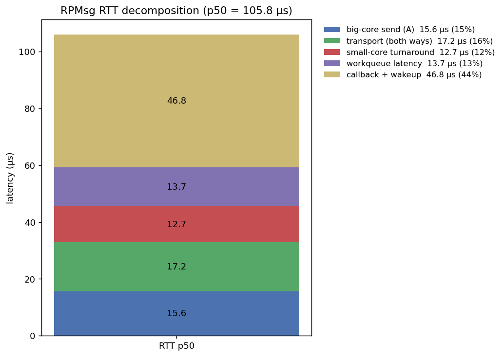
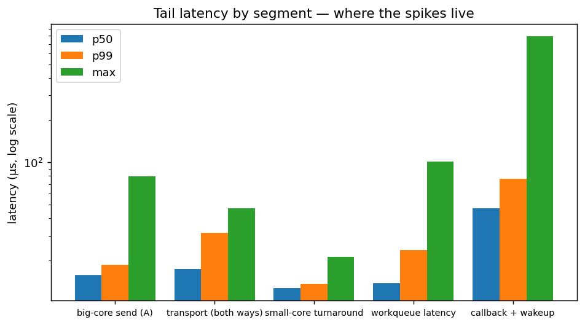
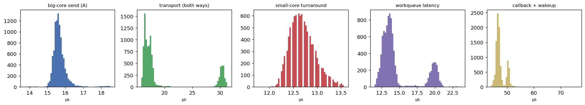

# vendor 5.10 基線：SDK patch、量測工具與原始數據

主線（mainline 7.0-rc6 移植）見 `linux7-migration.md`。本文件說明併入本 repo 的
**vendor 5.10 對照組**：同一塊 Duo256M 跑原廠 5.10 SDK 時的 RPMsg 堆疊與 RTT 量測。
它們原本分散在另外兩個 repo：

| 來源 | 內容 | 併入位置 |
|---|---|---|
| [jeremylu0830/milkv_sdk](https://github.com/jeremylu0830/milkv_sdk) | duo-buildroot-sdk-v2 v2.0.1 之上的 11 個 commit：HenryChaing 的 ADB、ThreadX submodule、C906L remoteproc、RPMsg glue（0001–0007）；Jeremy Lu 的 RTT 探針（0008–0011） | `patches/vendor-sdk/` |
| [jeremylu0830/duo-example-rtt](https://github.com/jeremylu0830/duo-example-rtt) | duo-examples 的 `rpmsg_userspace/`：HenryChaing 的 pingpong / LED 測試；Jeremy Lu 的 RTT bench、decomp4 分解、分析腳本 | `bench/vendor-5.10/`（程式）、`bench/data/vendor-5.10/`（數據與圖） |

兩邊的 commit 都以原作者署名保留在本 repo 歷史中
（`git log -- patches/vendor-sdk bench/vendor-5.10`）。上游 SDK 與 duo-examples
未經修改的部分（約 1 GB）沒有收進來；原 repo 裡誤提交的 ELF 執行檔也沒有收。

`patches/linux/` 退役的 vendor glue（`cvi_rpmsg_shmem.c`、`rtos_cmdqu.c`）就是
`patches/vendor-sdk/0004` 引入的那一份。

## 重現

### SDK（kernel 5.10 + ThreadX + rootfs）

```sh
git clone https://github.com/milkv-duo/duo-buildroot-sdk-v2.git
cd duo-buildroot-sdk-v2
git checkout v2.0.1                         # 6b03c27
git am /path/to/duo256m-mainline-amp/patches/vendor-sdk/*.patch
```

整串套在 v2.0.1 上之後，tree 與 `milkv_sdk@8fd17ca` 完全相同（已比對 tree hash）。

### ThreadX（C906L 韌體）

ThreadX 是 submodule（[HenryChaing/ThreadX-to-RISC-V64](https://github.com/HenryChaing/ThreadX-to-RISC-V64)，`amp` 分支），
但 `0010` / `0011` 指向的 `f0d2c71` / `5bfc09f` 不在任何公開 repo 上，
`git submodule update` 會失敗。改從 `amp` 分支頭 `49ad38f` 起手。這個 commit 同時是：

- `patches/vendor-sdk/0007` 把 submodule 指向的版本（Jeremy 的改動之前）；
- 本 repo `patches/threadx/` 全部 7 個 patch 的基底（已用 `git am` 驗證）。

也就是說，vendor 和 mainline 兩條線的韌體出自同一個基底，差別只在上面疊了哪些 patch。

```sh
git clone -b amp https://github.com/HenryChaing/ThreadX-to-RISC-V64.git threadx
git -C threadx checkout 49ad38fbd540c9709e322abd38f520218e5beaf9   # 固定版本，amp 之後若前進也不受影響
```

| 做法 | 韌體 | 能跑的工具 |
|---|---|---|
| A：原版 | `49ad38f`，不加 patch | `mailbox_pingpong`、`mailbox_led`、`rpmsg_rtt_bench` |
| B：帶時間戳 | `49ad38f` + `patches/threadx/0001–0003` | 以上全部，加上 `rpmsg_rtt_decomp4_stamp` |

做法 B：

```sh
git -C threadx am /path/to/duo256m-mainline-amp/patches/threadx/000[1-3]-*.patch
```

- `0001`：開 mailbox 中斷之前先清掉殘留的狀態；
- `0002`：拿掉熱路徑上的 printf，回覆改成 24B，帶回 s1（mailbox ISR 進入）與
  s3（`rpmsg_lite_send` 之前）兩個 `rdtime` 時間戳；
- `0003`：回覆長度跟著請求（最多 496B，前 24B 照帶時間戳），小於 24B 的請求一律回 24B。

三個 patch 只改 `cvitek/task/comm/src/riscv64/comm_main.c`，送回 Linux 的 mailbox kick
編碼與原版相同。

**不要套 `0004–0007`。** 以下是讀程式碼的推論，沒有上板驗證：

- `cmdqu_t` 的第 2 個 byte 是 `cmd_id:7` + `block:1`。原版韌體的 `mailbox_send()`
  設 `block = 0`；`0004` 的 `platform_notify()` 直接寫 `((vq & 1) + 128) << 8`，
  把 `block` 設成 1。
- vendor kernel 的 `rtos_irq_handler()`（`patches/vendor-sdk/0004`）遇到
  `rtos_valid == 1 && block == 1` 只會去喚醒 `rtos_cmdqu_send_wait()` 的等待者，
  不會呼叫 RPMsg glue 註冊的 `rtos_cmdqu_handler()`，host 因此永遠不處理 virtqueue。
  `patches/linux/0001` 移植的 glue 也是同一段判斷。
- `0005` 改寫的正是 `0004` 的 `platform_notify()`，`0006`、`0007` 疊在它們上面，
  所以整段 `0004–0007` 都不適用。
- `0004` 加的 resource table 不是問題：vendor remoteproc 把 `parse_fw` 設成 `NULL`
  （`patches/vendor-sdk/0003`），不會讀它。

`0004` 的 commit message 說仍相容 vendor `rtos_cmdqu` 的 host ISR，那只考慮了 slot 掃描，
沒有考慮 block 位元。

SDK 建置流程照上游 README（`./build.sh lunch`，選 `milkv-duo256m-musl-riscv64-sd`）；
`0008` 在 SDK 根目錄加了 `step_by_step_compilation.sh`（分步建置的環境設定）與
`remoteproc.sh`（板端把 `cvirtos.elf` 放進 `/lib/firmware` 並經 sysfs 啟動 C906L）。

### userspace 工具

Makefile 只吃 duo-examples `envsetup.sh` 匯出的 `TOOLCHAIN_PREFIX` / `CFLAGS` / `LDFLAGS`：

```sh
git clone https://github.com/milkv-duo/duo-examples.git
cd duo-examples && source envsetup.sh       # 選 2 (Duo256M) → 2 (RISCV64)
make -C /path/to/duo256m-mainline-amp/bench/vendor-5.10
```

| 工具 | 作者 | 用途 | 前提 |
|---|---|---|---|
| `mailbox_pingpong` | HenryChaing | 16 回合 pingpong 通訊驗證 | – |
| `mailbox_led` | HenryChaing | 經 RPMsg 設定小核 LED 閃爍週期 | – |
| `rpmsg_rtt_bench` | Jeremy Lu | 素身 RTT（write → poll → read），4B × 10k → `rtt_samples.csv` | – |
| `rpmsg_little_core_cost` | Jeremy Lu | RTT 扣掉小核 turnaround → `rtt_decomp.csv` | Jeremy 版韌體的 8B turnaround 樁（未公開） |
| `rpmsg_rtt_decomp4` | Jeremy Lu | 四段拆解 → `rtt_decomp4.csv` | `0008`+ 的 kernel 探針、Jeremy 版韌體的 8B turnaround 樁（未公開） |
| `rpmsg_rtt_decomp4_stamp` | YTing46（改自 decomp4） | 同樣的四段拆解，turnaround 改用韌體 s1/s3 時間戳 → `rtt_decomp4_stamp.csv`（`rtt.py` 可直接讀） | `0008`+ 的 kernel 探針、做法 B 的韌體 |
| `rtt.py` | Jeremy Lu | 分析 `rtt_decomp4.csv`、輸出三張圖 | numpy、matplotlib |

這裡的工具寫死 vendor 的 channel 名稱 `rpmsg-openamp-demo-channel`（0x1e）；
mainline 版工具在 `bench/`。

## 量測方法（decomp4）

| 時間點 | 位置 | 時鐘 |
|---|---|---|
| t0 / t1 | userspace `write()` 前 / `read()` 後 | `CLOCK_MONOTONIC` |
| b1 | `cvi_rpmsg_notify()`，`rtos_cmdqu_send()` 之前（只記 TX vq） | `ktime_get_ns()` |
| b2 | `rtos_cmdqu_handler()`：小核回覆的中斷進入 | `ktime_get_ns()` |
| b2b | `rpmsg_work_handler()`：workqueue 開始執行 | `ktime_get_ns()` |
| turnaround | 小核韌體自量，放進 8B 回覆帶回 | 25 MHz ticks |

kernel 時間點經 `/proc/cvi_rpmsg_probe` 匯出，每回合讀一次。分段：

- **A**（大核送出）= b1 − t0
- **workqueue** = b2b − b2
- **callback**（vq callback + 喚醒 userspace）= t1 − b2b
- **turnaround** = 韌體回報值
- **transport** = RTT − A − (t1 − b2) − turnaround：殘差，包含 mailbox 送出成本與雙向傳輸

不滿足 t0 ≤ b1 ≤ b2 ≤ b2b ≤ t1 的樣本會被丟棄。存檔的數據 10000/10000 筆全數有效。

`0009` / `0011` 另外加了六個 `rdtime` 原始時間戳（b1_raw、b1_done_raw、b2_raw、
b2_sched_raw、b2b_raw、b_cb_done_raw），`/proc/cvi_rpmsg_probe` 變成 9 欄。
前 5 欄與舊格式相容，decomp4 只讀前 3 欄，所以仍可使用。這組時間戳與韌體 `rdtime`
同源，用途和 mainline 版 `rpmsg_rtt_decomp.c` 相同：把 transport 拆成正反兩段直接量測。
對應的 decomp5 userspace 工具與數據沒有在任何 repo 裡。

### decomp4_stamp 的差異

`rpmsg_rtt_decomp4_stamp` 的探針、分段公式和 CSV 欄位都與 decomp4 相同，只有小核那段不同：

- turnaround = (s3 − s1) × 40 ns，s1 = mailbox ISR 進入，s3 = `rpmsg_lite_send` 之前。
  Jeremy 版樁的位置未公開，所以 turnaround（以及由殘差算出的 transport）不能假設與
  `rtt_decomp4.csv` 同定義，要當成另一組數據。
- 請求 8B（同 decomp4），回覆 24B（decomp4 是 8B），多出的 16B 會反映在韌體與 host 的 copy 成本上。
- 丟棄樣本的規則：順序錯位（同 decomp4）；時間戳無效（長度不是 24B、沒有 magic、s3 < s1、
  換算溢位）；turnaround 超出 b1 到 b2 之間的時間（s1 是更早的 ISR 留下的）。兩類分開計數並印出。
  因為 turnaround 不會超過 b2 − b1，transport 殘差不需要像 decomp4 那樣在負值時夾成 0。
  暖機的第一筆回覆如果沒有時間戳，直接中止並提示韌體要套哪些 patch。
- 只有量測完成且 CSV 完整寫出才回傳 0。CSV 先寫到同目錄下用 `mkstemp` 建立的暫存檔，
  成功後才改名成 `rtt_decomp4_stamp.csv`，失敗的執行不會覆寫上一份數據。
- s1 每次 mailbox ISR 都會被覆寫。過期但數值合理的 s1 從回覆本身看不出來，這是這個方法的限制。

## 數據（本板 vendor 5.10，Jeremy Lu，2026-06）

| 檔案 | 工具 | payload | 樣本 | p50 | p90 | p99 | max |
|---|---|---|---|---|---|---|---|
| `rtt_samples.csv` | `rpmsg_rtt_bench` | 4B | 10k | **75.3** | 121.4 | 7239.9 | 7564.5 |
| `rtt_decomp4.csv` | `rpmsg_rtt_decomp4` | 8B | 10k | **105.8** | 129.4 | 141.5 | 849.8 |

（µs）兩份數據的探針、payload 與韌體都不同，不能直接相減。`rtt_samples.csv` 有
117 筆（1.2%）超過 5 ms，原 repo 沒有分析成因。

decomp4 分段（µs）：

| 分段 | p50 | p99 |
|---|---|---|
| A 大核送出 | 15.6 | 18.5 |
| transport（殘差） | 17.2 | 31.3 |
| 小核 turnaround | 12.7 | 13.6 |
| workqueue | 13.7 | 23.6 |
| callback + 喚醒 | 46.8 | 76.3 |
| **RTT** | **105.8** | **141.5** |

五段 p50 加總 106.0µs，與 RTT p50 相差 0.2µs，分解自洽。





## 與 mainline 終態的分段對照

兩邊都是插探針的版本，數量級可以比，但探針組不同：mainline 版回覆帶 24B stamp，
自述比素身 bench 慢約 17µs；vendor 版回覆 8B，每回合多讀一次 `/proc`。
個位數 µs 的差距不宜過度解讀。

| 分段 | vendor 5.10 decomp4 | mainline 7.0 終態<br>（`native-hardirq-decomp.csv`，4B，2000 筆） | 對應 |
|---|---|---|---|
| 大核送出 | A 15.6 | syscall_in 20.4 | 定義相同：`write()` 進入 → kick 前 |
| 送出 + 傳輸 | transport 17.2（殘差） | notify 4.9 + transport 27.0 | mainline 用 s1/s3 `rdtime` 直接量 |
| 小核 | turnaround 12.7 | turnaround 14.1 | 韌體樁位置可能不同（vendor 版未公開） |
| 中斷 → 派發 | workqueue 13.7 | workwait 1.6 | mainline 終態在硬中斷直送 |
| 交付 + 喚醒 | callback 46.8 | wake 64.6 | |
| **RTT p50** | **105.8** | **127.6** | |

以本板 decomp4 為基準，mainline 終態慢 21.8µs。差距集中在交付＋喚醒（+17.8）
與送出＋傳輸（+14.7）；中斷到派發這一段 mainline 反而少了 12.1µs。
README 與 `linux7-migration.md` 的「距 vendor 13.6µs」是對 Henry 基線
（decomp5，32B）的 114.0µs 計算的，不是這份數據。

若改用做法 B 的韌體與 `rpmsg_rtt_decomp4_stamp` 重量 vendor 端，小核那一段就和 mainline
用同一組 s1/s3 時間戳、同一個 turnaround 定義，可以直接對比；mainline 韌體另外套了
`0004–0007`，kick 路徑仍然不同。

## 已知缺口

1. **Jeremy 的 ThreadX 修改未公開。** decomp4 / little_core_cost 依賴的 8B turnaround 樁，
   以及 `0010` / `0011` 的 submodule commit（`f0d2c71`、`5bfc09f`），都只存在
   Jeremy Lu 本機。要重現 `rtt_decomp4.csv` 本身，仍需要他推到 ThreadX fork，
   再補一個 submodule URL 的 patch。只需要 vendor 端的分段數據的話，可以改用做法 B
   加 `rpmsg_rtt_decomp4_stamp`，但那是新的一組數據，不是 `rtt_decomp4.csv` 的重現。
2. **decomp5 工具與數據缺席。** kernel 已輸出 9 欄，但讀取它的 userspace 工具與
   結果都不在任何 repo 裡。
3. **`rtos_cmdqu_handler` 原型。** `0009` 把它改成 variadic
   `(unsigned char cmd_id, ...)`，但 `rtos_cmdqu.c` 仍以固定三參數的
   `irq_request_func` 呼叫它。這在 C 語意上屬未定義行為；RV64 LP64 呼叫慣例下
   整數參數同樣走 a0–a2，所以實際能跑。
4. **探針是全域變數**，前提是同時只有一筆訊息在飛（ping-pong）；b1 只在 TX vq
   （`simple_id == 1`）記錄。
5. **做法 B 尚未上板驗證。** 目前只確認 `patches/threadx/0001–0003` 能套在 `49ad38f` 上、
   `rpmsg_rtt_decomp4_stamp` 能編譯，以及上面那段讀程式碼的推論。
